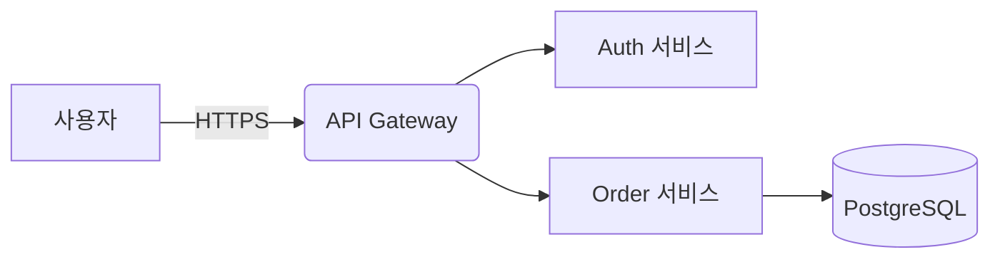
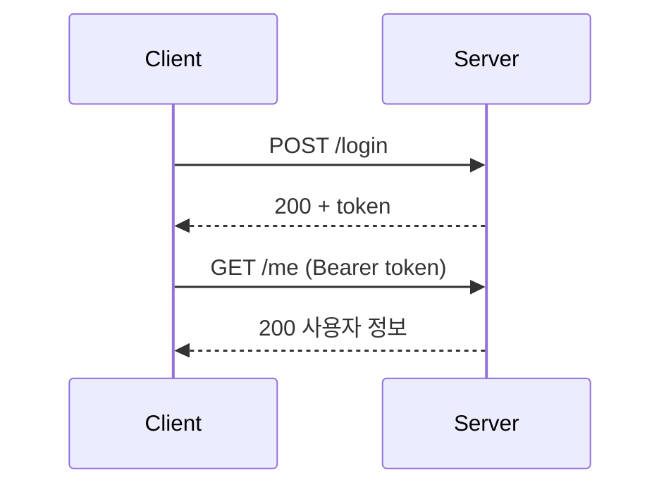

## 개요
Mermaid는 다이어그램을 텍스트로 작성하면 브라우저에서 SVG로 렌더링하는 라이브러리다. 텍스트라서 Git diff·코드 리뷰가 가능하고, GitHub·GitLab Markdown은 ```` ```mermaid ```` 코드 블록을 바로 그리고, Docusaurus·VitePress 같은 문서 도구는 플러그인으로 지원한다. 이 문서는 **12.x** 기준(npm latest 12.3.0, MIT). 12.0(2026-09)은 ELK를 기본 레이아웃 엔진으로 바꾸고 기본 스타일을 변경한 호환성 깨짐 릴리스라, 이전 모양을 유지하려면 `layout: dagre`, `look: classic`을 설정한다.

## 설치
```bash
npm install mermaid
# 파일을 SVG/PNG 로 변환하는 CLI
npx -p @mermaid-js/mermaid-cli mmdc -i diagram.mmd -o diagram.svg
```
웹에서 바로 그려 보려면 Mermaid Live Editor를 쓴다.

## 핵심 개념
| 다이어그램 | 첫 줄 | 용도 |
| --- | --- | --- |
| 플로차트 | `flowchart LR` | 처리 흐름, 아키텍처 개략 |
| 시퀀스 | `sequenceDiagram` | API 호출 순서, 인증 흐름 |
| 클래스 | `classDiagram` | 객체 관계 |
| 상태 | `stateDiagram-v2` | 상태 기계 |
| ER | `erDiagram` | DB 테이블 관계 |
| 간트 | `gantt` | 일정 |
| Git 그래프 | `gitGraph` | 브랜치 전략 설명 |

## 기본 사용법
플로차트:



시퀀스:



웹 페이지에 직접:

```js
import mermaid from 'mermaid';
mermaid.initialize({ startOnLoad: true, theme: 'default' });
// <pre class="mermaid">flowchart TD; A-->B</pre> 요소를 찾아 렌더링
```

## 자주 쓰는 패턴
- **README 다이어그램.** GitHub Markdown에서 ```` ```mermaid ```` 블록이 그대로 렌더링된다.
- **설정 프런트매터.** 다이어그램 맨 위 `---\nconfig:\n  theme: neutral\n---`로 개별 설정.
- **문서 사이트 연동.** [Docusaurus](/develop-wiki/devtools/docs/docusaurus/)는 `@docusaurus/theme-mermaid`, [MkDocs Material](/develop-wiki/devtools/docs/mkdocs-material/)은 superfences 설정으로 지원.
- **CI에서 이미지 생성.** `mmdc`로 SVG를 만들어 Mermaid를 지원하지 않는 곳(슬라이드, PDF)에 넣는다.

## 언제 쓰나 / 피할 때
- 쓸 때: 코드와 함께 버전 관리되는 설계 문서·README 다이어그램.
- 피할 때(대안): 레이아웃을 세밀하게 손봐야 하는 발표용 그림은 draw.io·Excalidraw 같은 그리기 도구. 대형 UML·C4 모델은 PlantUML·Structurizr도 검토.

## 공식 문서
- [소개](https://mermaid.js.org/intro/) · [문법 레퍼런스(플로차트)](https://mermaid.js.org/syntax/flowchart.html) · [설정](https://mermaid.js.org/config/configuration.html)
- [Live Editor](https://mermaid.live/) · [mermaid-cli](https://github.com/mermaid-js/mermaid-cli) · [릴리스](https://github.com/mermaid-js/mermaid/releases)
